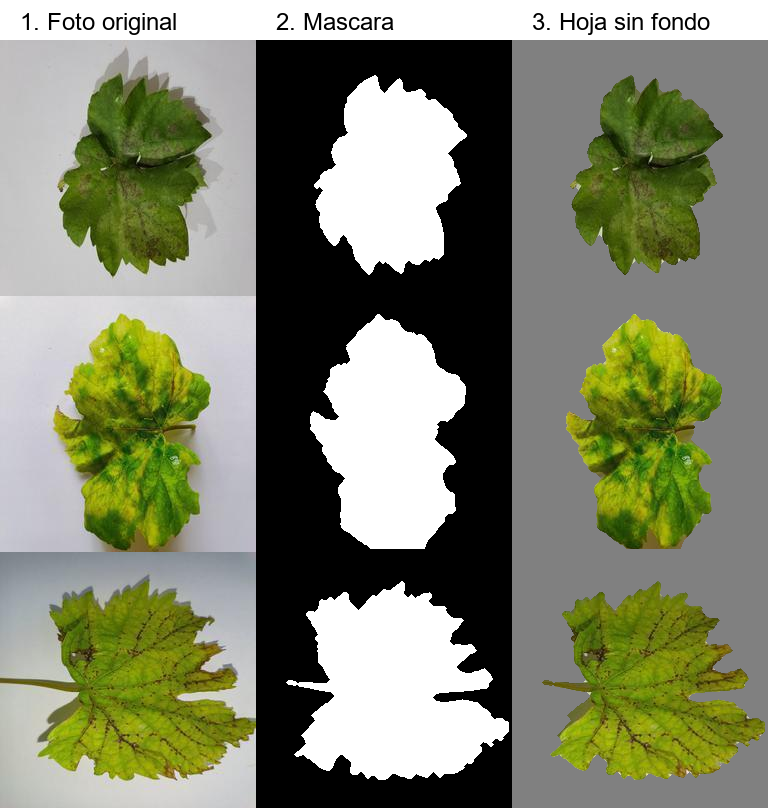

# 🍇 Detección de enfermedades en hojas de vid

Proyecto final de Inteligencia Artificial — Enzo y Tato.

## ¿Qué hace?
Le das una foto de una hoja de vid y te dice si está **sana** o si tiene
**mildiu**, **oídio** o **mancha bacteriana**.

## ¿Cómo funciona?
Lo hacemos en dos pasos, como haría una persona: primero encontrar la hoja, después mirarla.

    Foto  ──►  UNet  ──►  Hoja recortada  ──►  CNN  ──►  Diagnóstico
              "¿dónde está     (sin fondo)       "¿qué tiene
               la hoja?"                           la hoja?"

1. **UNet (segmentación):** una red que pinta, píxel por píxel, qué parte de la foto es hoja
   y qué parte es fondo. Con eso recortamos la hoja y borramos el fondo.
2. **CNN (clasificación):** una red ya entrenada con millones de imágenes (MobileNetV2) que
   reentrenamos para reconocer nuestras 4 clases. Esto se llama *transfer learning*.

## ¿Por qué separar la hoja primero?
Si la red ve el fondo, puede "hacer trampa": aprender que *fondo gris = mancha bacteriana*
en vez de mirar la enfermedad. Por eso entrenamos la CNN **dos veces** —con fotos originales
y con hojas recortadas— y comparamos. Con mapas de calor (Grad-CAM) vemos dónde mira la red.

## ¿Qué son las máscaras?

Una **máscara** es una imagen en blanco y negro del mismo tamaño que la foto:
**blanco = hoja**, **negro = fondo**. Es como el molde para recortar la hoja con tijera.

**¿Para qué sirven?** Para enseñarle a la UNet. Toda red aprende viendo ejemplos con la respuesta correcta:

| Red  | Ve...        | Tiene que responder...                 | ¿Tenemos la respuesta? |
|------|--------------|----------------------------------------|------------------------|
| CNN  | foto de hoja | una palabra: "mildiu"                  | Sí: el nombre de la carpeta |
| UNet | foto de hoja | una **máscara** (dónde está la hoja)   | **No: hay que fabricarlas** |

**¿Cómo las fabricamos?** Dibujar 2726 a mano sería eterno. Usamos un truco: el fondo es
blanco o gris y la hoja tiene color (verde, amarilla, marrón). Un programa simple separa
"lo que tiene color" de "lo que no".

**¿Y entonces para qué la UNet?** Porque el truco **se equivoca con sombras, ramas o fondos
de colores**: en la imagen de arriba, la última máscara tiene una franja de más por una sombra.
La UNet aprende **la forma de una hoja de vid**, así que funciona donde el truco falla
(por ejemplo, con fotos sacadas en el viñedo).

> El truco fabrica los ejemplos → la UNet aprende de ellos a hacerlo mejor.

**Lo que tenemos que hacer nosotros:**
1. **Revisar:** mirar grillas con las máscaras automáticas y anotar las que salieron mal,
   para que la UNet no aprenda errores.
2. **Corregir unas 50 a mano** (con Paint o GIMP, pintando blanco y negro). Esas 50 son el
   "examen" de la UNet: comparamos su recorte con el correcto y sale un puntaje llamado
   **IoU** (100% = recorte perfecto).

## ¿Qué es Grad-CAM? (el mapa de calor)
Es una técnica que muestra **en qué parte de la foto se fijó la red** para decidir.
Pinta encima de la imagen un mapa de calor: **rojo = "acá miré mucho"**, **azul = "esto no me importó"**.
Es como pedirle a alguien que, además de decir "es mildiu", **señale con el dedo** dónde lo vio.

**¿Para qué nos sirve?** Una red puede acertar **por el motivo equivocado**:

| Si el mapa de calor marca... | Significa... |
|---|---|
| las manchas de la hoja | ✅ aprendió la enfermedad |
| el fondo, una sombra o una rama | ❌ "hace trampa": aprendió algo de las fotos, no de la enfermedad |

Ejemplo: si todas las fotos de mancha bacteriana tuvieran fondo oscuro, la red podría aprender
"fondo oscuro = mancha bacteriana" y acertar igual. Grad-CAM lo dejaría en evidencia. Por eso
comparamos los mapas de calor de la red **con fondo** y **sin fondo**.

**¿Cómo funciona?** (*Gradient-weighted Class Activation Mapping*, Selvaraju et al., 2017)
1. La última capa convolucional produce muchos **mapas chiquitos (7×7)**. Cada uno detecta un
   patrón (bordes amarillos, puntitos, textura) y dice **en qué zona** lo encontró.
2. Con los **gradientes** (la misma herramienta del entrenamiento) se mide cuánto influye cada
   mapa en la clase elegida (por ejemplo, "mildiu").
3. Se suman los mapas multiplicados por su importancia, se dejan solo los valores positivos y se
   agranda el resultado al tamaño de la foto.

> En una frase: *qué zonas activaron los detectores que más empujaron hacia esa clase*.

**Limitaciones:**
- **Es borroso:** sale de una grilla de 7×7, así que marca zonas aproximadas, no manchas exactas.
- **Muestra *dónde* miró la red, no *por qué*:** hay que interpretarlo.
- **No mide el tamaño de las manchas:** no es una segmentación de la lesión.

## La aplicación
Una página web que corre **en nuestra compu** (no está publicada en internet) y tiene 2 pestañas:

- **Diagnosticar:** subís una foto, o la sacás con la cámara, y muestra:
  - la hoja que detectó la UNet;
  - la probabilidad de cada clase;
  - un **mapa de calor** con la parte de la hoja en la que se fijó la red.

  Trae una foto de ejemplo de cada clase.
- **Con fondo vs sin fondo:** la misma foto pasa por la red entrenada **con fondo** y por la
  entrenada **sin fondo**, lado a lado. Así se ve en vivo si el fondo cambia el resultado.

Siempre muestra el aviso: *"Resultado aproximado. La interpretación y las acciones a seguir
corresponden al ingeniero agrónomo."*

### ¿Cómo pasa la red del notebook a la app?
**Entrenar** y **usar** la red son dos momentos distintos, y los une **un archivo**:

    1. ENTRENAR (notebook, en Colab)          2. USAR (la app, en la compu)
    ┌────────────────────────────┐            ┌────────────────────────────┐
    │ la red ve 2000 fotos       │            │ carga el archivo           │
    │ y aprende (minutos/horas)  │            │ (1 segundo)                │
    │                            │            │                            │
    │ al final:                  │  archivo   │ recibe UNA foto nueva      │
    │ model.save("clf_B.keras") ─┼──────────► │ y responde: "Mildiu 82%"   │
    └────────────────────────────┘  .keras    └────────────────────────────┘

- Lo que la red "aprendió" son millones de números (los **pesos**). `model.save()` los guarda en un archivo `.keras`.
- La app **no vuelve a entrenar**: abre ese archivo y le pasa fotos nuevas.
- Es como estudiar y rendir: el notebook es estudiar (lento, una vez) y la app es rendir (un segundo, cada vez que alguien sube una foto).

**Qué hace la app con cada foto:**
1. **UNet** (`unet.keras`): calcula la máscara de la hoja.
2. **Recorte:** borra el fondo con la misma función del notebook.
3. **CNN** (`clf_B.keras`): calcula las probabilidades de cada clase.
4. **Grad-CAM:** arma el mapa de calor.
5. **Gradio:** muestra todo en una página web.

**Gradio** es una librería de Python que convierte una función ("recibo una foto → devuelvo resultados") en una página web, sin escribir HTML.

El notebook y la app usan **las mismas funciones** (están en `utils.py`). Así la app da exactamente los mismos resultados que medimos en el notebook.

**Para abrirla:**
1. Bajar los modelos de la carpeta de Drive a `models/`: `unet.keras`, `clf_A.keras` y `clf_B.keras`.
2. Correr:

       python app/app.py

3. Abrir en el navegador: `http://localhost:7860`

No necesita internet ni placa de video.

## Los datos
2726 fotos de hojas (256×256 píxeles):

| Clase              | Fotos |
|--------------------|------:|
| Sana               | 1254  |
| Mildiu             |  966  |
| Oídio              |  406  |
| Mancha bacteriana  |  100  |

Hay muy pocas de mancha bacteriana: eso es un desafío y lo tenemos en cuenta al entrenar.

## ⚠️ Importante: es una aproximación, no un diagnóstico definitivo
El modelo **no determina al 100%** si la hoja tiene una enfermedad. Las manchas o defectos
en una hoja pueden tener **otras causas**: falta de nutrientes,falta de agua, quemaduras de sol, daño de
insectos, productos químicos u otras enfermedades que el modelo no conoce.

Además, la red solo conoce 4 opciones, así que **siempre va a elegir una de ellas**, aunque
la causa real sea otra.

Por eso el modelo **no da recomendaciones**: solo informa la clase más probable y la
probabilidad de cada una. **Qué hacer con ese resultado** (por ejemplo, enviar la hoja al
laboratorio) **lo decide el ingeniero agrónomo**.

## Estructura del proyecto
| Archivo / carpeta            | Qué es |
|------------------------------|--------|
| `01_mascaras.ipynb`          | Crea las máscaras (hoja vs. fondo) para entrenar la UNet |
| `02_unet_segmentacion.ipynb` | Entrena la UNet y recorta todas las hojas |
| `03_clasificacion.ipynb`     | Entrena la CNN, compara con/sin fondo y muestra resultados |
| `utils.py`                   | Funciones compartidas |
| `app/`                       | La aplicación de demo (Gradio) |
| `dataset/`                   | Fotos originales (no se modifican) |
| `figuras/`                   | Gráficos para la presentación |
| `docs/`                      | Consigna, paper del dataset y plan para el agente |
| `avances/`                   | Registro de todo lo que hacemos y cambiamos, día por día |
| `AGENTS.md` / `CLAUDE.md`    | Instrucciones para agentes de IA (qué leer, reglas, flujo) |

**¿Vas a trabajar con un agente de IA (Claude Code, Codex, Cursor...)?** No hace falta
explicarle nada: lee solo `AGENTS.md`, que le dice qué leer, qué reglas seguir y cómo
registrar los avances. Si no lo lee solo, decile: *"Leé AGENTS.md y seguí sus instrucciones"*.

## Flujo de trabajo (Google Colab)
El código se escribe en la compu, y **el entrenamiento se hace en Google Colab** porque da
una placa de video (GPU) gratis: lo que en la compu tarda una hora, en Colab tarda minutos.

    Compu (escribir código)  ──►  Google Drive (guardar)  ──►  Colab (entrenar)
             ▲                                                     │
             └──────────  bajar figuras y resultados  ◄────────────┘

**Una sola vez:**
1. Crear en Google Drive la carpeta `Mi unidad/Proyecto_Final_IA/`.
2. Subir ahí toda la carpeta del proyecto (el dataset pesa solo 32 MB).
3. Compartir esa carpeta con el compañero (con permiso de edición).

**Cada vez que se trabaja:**
1. Si cambió el código en la compu, subir los archivos nuevos a Drive (reemplazando los viejos).
2. Abrir el notebook desde Drive con Colab (clic derecho → Abrir con → Google Colaboratory).
3. Activar la GPU: *Entorno de ejecución → Cambiar tipo de entorno → GPU T4*.
4. Ejecutar todo: *Entorno de ejecución → Ejecutar todas*. La primera celda pide permiso
   para acceder a Drive: aceptar.
5. Los modelos, figuras y resultados se guardan solos en Drive.
6. Bajar `figuras/` y `resultados/` a la compu para la presentación y el informe.

**Ojo:**
- Ejecutar los notebooks **en orden** (01 → 02 → 03): cada uno usa lo que generó el anterior.
- Colab corta la sesión si queda inactiva un rato o después de varias horas: como todo se
  guarda en Drive, solo hay que volver a ejecutar.
- No trabajar los dos en el mismo notebook al mismo tiempo: se pisan los cambios.

## Cómo correrlo en la compu (alternativa)
    pip install -r requirements.txt
    jupyter notebook
Mismos notebooks, mismo orden. Funciona sin placa de video, pero entrenar tarda bastante.

## Resultados
_Se completa cuando terminemos de entrenar._
