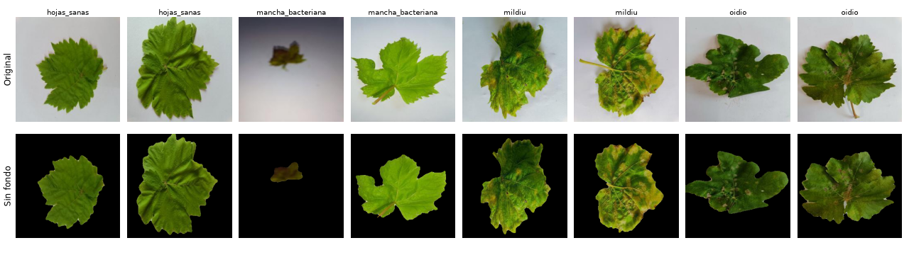
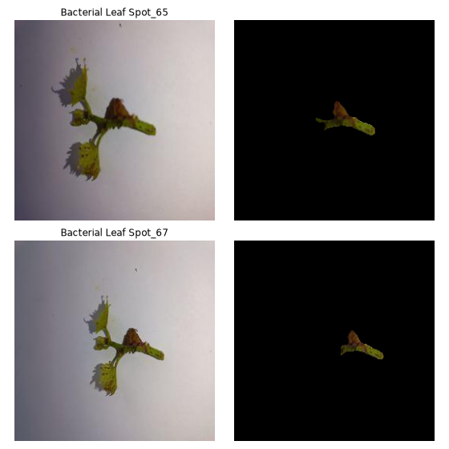
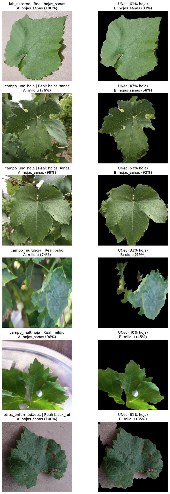
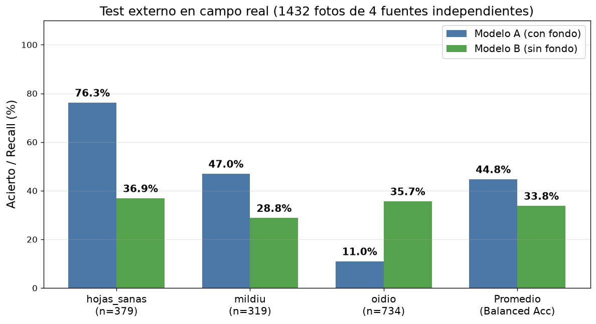

# 2026-11-24

**Quién:** Tato / Antigravity

## Qué hicimos
- Tato corrigió a mano las **39 fotos difíciles de `train`** en `masks/manual_train/` con `scripts/corregir_mascaras.py todas --train`.
- Separamos `dataset/mildiu/Downy Mildew_962.png` de `masks/manual_train/` (era una rama entera con más de 7 hojas encimadas que rompe la regla de "una hoja por foto"; quedó excluida en `masks/rechazadas.txt`).
- Auditamos las 39 máscaras corregidas y rearmamos `dataset_unet/` y `dataset_unet.zip` (58 MB) con `scripts/armar_dataset_unet.py`.
- Entrenamos la **UNet v6** (`MobileNetV2` preentrenado en ImageNet + decodificador UNet + 2 fases, misma arquitectura de `v5`, ahora con las 39 máscaras `manual_train` sobremuestreadas ×3 solo en `train`) en WSL2 con la RTX 5060 Ti.
- Actualizamos la sección de conclusiones de `scripts/crear_nb_02_unet.py` y regeneramos `02_unet_segmentacion.ipynb`.

## Decisiones (y por qué)
- **Cerrar la Fase 1 (UNet) con la versión v6 (`models/unet.keras`, 65 MB, `IoU = 0.941`):** por primera vez superó al truco automático en promedio general (`0.941` vs `0.934`) y rompió el techo de `0.931` que habían mostrado las 5 iteraciones previas (`v1`–`v5`).
- **Dejar afuera `Downy Mildew_962.png`:** no tiene una hoja principal separable y violaba la regla de una hoja por foto.

## Archivos creados o modificados
- `masks/manual_train/`: 39 máscaras corregidas a mano (`256×256`, 0/255), `LISTA.txt` (39 rutas), `revisadas_todas.txt` y baja de `Downy Mildew_962.png`.
- `scripts/crear_nb_02_unet.py` y `02_unet_segmentacion.ipynb`: conclusiones actualizadas con los números reales de v6.
- `avances/2026-11-24.md` y `avances/README.md`.
- Generados en local (`.gitignore`): `dataset_unet/`, `dataset_unet.zip` (58 MB), `models/unet.keras` (65 MB, copia archivada en `models/unet_v6_final.keras`), `resultados/unet_*.csv`, `figuras/unet_*.png` (y respaldos en `resultados/v6/`, `figuras/v6/`).

## Resultados / números (reales)
### Auditoría de `masks/manual_train/` y nuevo `dataset_unet/`
- **39/39 máscaras válidas** (`256×256`, estrictamente `0` y `255`); todas tuvieron cambios reales respecto a la automática, entre **5,7%** (`Healthy Leaves_1020`) y **56,6%** (`Bacterial Leaf Spot_99`). Mayores cambios: `Bacterial Leaf Spot_99` (56,6%), `Powdery Mildew_7` (50,0%), `Healthy Leaves_1056` (46,9%), `Healthy Leaves_1003` (44,8%), `Downy Mildew_960` (37,0%), `Bacterial Leaf Spot_85` (33,0%) y mildius blanquecinos (`895`, `830`, `847`, `953`, `840`, `785`: 25%–31%).
- `dataset_unet/`: **1576 train** (`+34` rescatadas de `rechazadas.txt` + `5` corregidas en el lugar) / **332 val** / **50 test** = **1958 pares** (`val` y `test` intactos, cero fuga de test). Con el balanceo (`mancha_bacteriana ×4` y `manual_train ×3`), `train` entrenó con **1837** ejemplos por época.

### Evaluación de UNet v6 en las 50 fotos de test (máscaras manuales)
- **Entrenamiento:** 2 fases (`10` épocas congelado + `33` de fine-tuning; mejor época **35 de 43**, `val_iou = 0.972`, 5.604.673 parámetros, 65 MB).
- **45 de 50 fotos (90%) ≥ `0.90`** · **39 de 50 fotos (78%) ≥ `0.95`** · **Mediana `0.967`** · **Promedio `0.941` (`+0.007` sobre el truco automático)**.

| Clase | v1 | v2 | v5 (`MobileNetV2`) | **v6 (+39 `manual_train`)** | Salto v5→v6 | Truco auto | v6 vs Truco |
|---|---:|---:|---:|---:|---:|---:|---:|
| `hojas_sanas` | 0.961 | 0.969 | 0.970 | **0.968** | -0.002 | 0.983 | -0.015 |
| `mancha_bacteriana` | 0.869 | 0.892 | 0.890 | **0.896** | +0.006 | 0.926 | -0.030 |
| `mildiu` | 0.924 | 0.930 | 0.933 | **0.958** | **+0.026** | 0.931 | **+0.028** |
| `oidio` | 0.920 | 0.930 | 0.927 | **0.938** | **+0.011** | 0.893 | **+0.045** |
| **Promedio** | **0.919** | **0.931** | **0.931** | **0.941** | **+0.010** | **0.934** | **+0.007** |

### Saltos clave en las fotos difíciles de test
| Foto | v1 | v2 | v5 | **v6** | Salto v5→v6 | Truco auto |
|---|---:|---:|---:|---:|---:|---:|
| `Downy Mildew_852` (mildiu blanco) | 0.678 | 0.674 | 0.719 | **0.943** | **+0.225** | 0.514 |
| `Powdery Mildew_395` (viñedo real) | 0.606 | 0.603 | 0.591 | **0.777** | **+0.186** | 0.057 |
| `Downy Mildew_838` (mildiu blanco) | 0.865 | 0.872 | 0.845 | **0.958** | **+0.113** | 0.835 |
| `Bacterial Leaf Spot_56` (rama) | 0.464 | 0.528 | 0.603 | **0.663** | **+0.060** | 1.000 |

- **`Downy Mildew_852` dejó de estar entre las peores** (de `0.67` a `0.94`).
- En **`Powdery Mildew_395`** (fondo verde real de viñedo), la UNet separó por primera vez la hoja principal de las hojas verdes de atrás (`0.59 → 0.78`, contra `0.06` del truco).
- Único caso que retrocedió algo: `Powdery Mildew_8` (`0.841 → 0.785`, aunque sigue prácticamente empatada con el truco `0.800`).

## Problemas
- Al intentar abrir `corregir_mascaras.py` desde Ubuntu/WSL faltaban librerías Qt/xcb para `cv2.imshow`; se resolvió ejecutándolo directo con el venv de Windows (`./proyecto-final-ia-2026-venv/Scripts/python.exe`) desde la misma terminal.
- En el inicio de la Fase 2 del entrenamiento hubo un pico puntual de `val_loss` en época 12 (época 2 de fine-tuning) del cual la red se recuperó de inmediato en la época 13 y convergió estable hasta la época 35.

## Pendiente
- Fase 2: usar `models/unet.keras` (v6) para generar `dataset_segmentado/` (las 2393 imágenes de `splits.csv` recortadas sin fondo).
- Construir y entrenar el notebook `03_clasificacion.ipynb` comparando **Clasificador A (con fondo)** vs **Clasificador B (sin fondo)** con `MobileNetV2` y `StratifiedGroupKFold(5)`.
- Armar la app local en Gradio (`app/app.py`).

---

## Prueba de cierre (v7): fondo sintético suave sobre v6 — descartada, se confirma v6 (`0.941`)
- **Quién:** Tato / Antigravity.
- **Qué hicimos:**
  - Probamos si sumar fondos sintéticos suaves (`7,5%` paleta natural + `7,5%` follaje real de `train` con suavizado leve `64×64`, sin escala de grises) encima de **v6** (`MobileNetV2` + las 39 máscaras `manual_train`) mejoraba todavía más las fotos de viñedo.
- **Resultados / números (reales, 50 fotos de test):**
  - **Promedio:** bajó de **`0.941` (v6)** → **`0.924` (v7)** (`-0.017`); mediana `0.967 → 0.966`.
  - Por clase: `hojas_sanas 0.967`, `mancha_bacteriana 0.837` (vs `0.896`), `mildiu 0.957`, `oidio 0.929` (vs `0.938`).
  - Empeoró incluso en las fotos de viñedo objetivo (`Powdery Mildew_395`: `0.777 → 0.729`; `Powdery Mildew_8`: `0.785 → 0.724`) y volvió a hundir `Bacterial Leaf Spot_56` (`0.663 → 0.002`) porque pegar recortes de hojas como fondo induce a rechazar hojas chicas o en el borde.
- **Decisión:** descartar `v7` (archivada localmente en `models/unet_v7.keras`, `resultados/v7/`, `figuras/v7/`) y **restaurar `v6` (`0.941`, 65 MB)** como modelo y código definitivos (`models/unet.keras`, `scripts/crear_nb_02_unet.py`, `02_unet_segmentacion.ipynb`). Queda demostrado en dos arquitecturas distintas (`v4` y `v7`) que las fotos reales corregidas a mano rinden claramente mejor que el fondo sintético.

## Juntar el trabajo de Enzo y de Tato (Enzo)
- **Quién:** Enzo con Claude.
- **Qué pasó:** Enzo tenía sin commit el orden en `datos/` y el notebook 02 simple del 23. Tato había subido 6 commits (UNet v1 a v7, `masks/manual_train/` y su notebook 02). El `git pull` se frenó porque tocaban los mismos archivos.
- **Decisión (Enzo):** el notebook 02 que queda es **el de Tato (v6, IoU 0.941)**, porque es el del mejor resultado. La versión simple de Enzo se guardó en `docs/referencias/unet_simple_enzo.ipynb`. Su entrenamiento en Colab (0.923, registrado el 23) fue con la versión anterior del notebook.
- **Qué se hizo:**
  1. Se guardaron los cambios de Enzo con `git stash` y se bajó lo de Tato.
  2. Se volvió a aplicar el orden encima: `splits.csv`, `casi_duplicados.csv` y `masks/` (con `manual_train/`) → `datos/`; `recursos/` → `docs/referencias/`.
  3. Rutas: `utils.py` (`DATOS` y `MASKS`, y se conservó la `bce_dice_loss` de Tato), `scripts/armar_dataset_unet.py`, `scripts/corregir_mascaras.py` y `scripts/crear_nb_02_unet.py`. Solo se cambiaron rutas: la lógica de Tato quedó igual.
  4. Se juntaron los dos registros del 23 (primero lo de Tato, después lo de Enzo, sin borrar nada) y el Índice.
  5. `docs/PLAN_AGENTE.md`: vuelve la regla de `REENTRENAR` (el notebook de Tato la usa) y queda la de explicar todo en pasos chicos.
- **Verificado:** `scripts/armar_dataset_unet.py` arma 1576 / 332 / 50 = 1958 pares con 39 máscaras de `manual_train`, igual que lo anotado por Tato. El notebook 02 de Tato corre sin errores con `SMOKE=1` (se borraron los archivos de la prueba).
- **Para Tato:** las rutas cambiaron (ver `README.md`). El entorno virtual ahora es `.venv/` (`python -m venv .venv` y `pip install -r requirements.txt`); `proyecto-final-ia-2026-venv/` ya no se usa. En Colab, el zip va en `Proyecto_Final_IA/datos/dataset_unet.zip`.
- **Pendiente:** commit y push (con permiso de Enzo); explicarle a Enzo el notebook 02 de Tato sección por sección.

## Aumentación al predecir (TTA) en la UNet (Enzo)
- **Quién:** Enzo con Claude (idea de Enzo, código de Claude a pedido de Enzo).
- **Contexto:** Enzo propuso hacer aumentación rotando y espejando. Eso ya estaba en el entrenamiento desde la v2 de Tato (espejado, rotaciones de 90° y color). Se aplicó la misma idea **al predecir**.
- **Qué se hizo:** sección nueva **7b** en `scripts/crear_nb_02_unet.py` (y se regeneró `02_unet_segmentacion.ipynb`). La función `predecir_tta` le pide la máscara a la UNet 8 veces (normal y espejada, rotada 0°, 90°, 180° y 270°), deshace cada transformación y promedia las 8. No hace falta volver a entrenar.
- **Decisión (y por qué):** primero se mide en **val** y recién después en test, porque ya se compararon 8 versiones contra las mismas 50 fotos de test y no hay que seguir eligiendo mirando el examen.
- **Verificado:** con un modelo falso que devuelve la misma foto, el promedio de las 8 da exactamente la original (las vueltas atrás están bien). El notebook corre sin errores con `SMOKE=1`. Los números de esa prueba **no valen** (red mini de 1 época), así que no se anotan como resultado.
- **Pendiente:** correrlo con el modelo v6 real (`models/unet.keras`, lo tiene Tato) y anotar el IoU en val y en test con y sin TTA.

## Entrenamiento en Colab con el zip viejo (Enzo)
- **Quién:** Enzo (Colab) con Claude.
- **Problemas al correr en Colab:** (1) `FileNotFoundError` en `datos/dataset_unet/lista.csv`: el zip seguía en la raíz de Drive y no en `datos/`; (2) `utils` sin `bce_dice_loss`: había un `utils.py` viejo en Drive. Se resolvieron subiendo los archivos nuevos y reiniciando la sesión.
- **Error de procedimiento:** se usó el **`dataset_unet.zip` viejo** (sin las 39 máscaras de `manual_train`). Como no estaba `models/unet.keras` en Drive, el notebook entrenó un modelo nuevo. Por eso es equivalente a la v5 de Tato, no a la v6.
- **Resultado (real, 50 fotos de test):** hojas_sanas 0.969, mancha_bacteriana 0.884, mildiu 0.925, oidio 0.927, **promedio 0.927** (truco 0.934). Coherente con la v5 de Tato (0.931).
- **Pendiente:** subir el zip nuevo (`datos/dataset_unet.zip`, 1576 en train con 39 manuales) o el modelo v6 de Tato a `models/unet.keras`, y medir la TTA.

## Resultado de la TTA con el modelo v6 (Enzo)
- **Quién:** Enzo con Claude.
- **Modelo:** Tato le pasó a Enzo `unet_v6_final.keras`, que llegó descomprimido como carpeta (un `.keras` es un zip con `config.json`, `metadata.json` y `model.weights.h5`). Claude lo volvió a armar como `models/unet.keras`; carga bien y tiene 5.604.673 parámetros, igual que la v6.
- **Dónde se corrió:** en la compu de Enzo, sin GPU. Con `REENTRENAR = False` el notebook carga el modelo y **no entrena**: solo predice. Tardó unos 25 minutos.
- **Resultados (reales):**
  - Sin TTA, test da **0.941**, igual que lo anotado por Tato: se confirma que es la v6.
  - **Val:** UNet 0.973 → UNet + TTA **0.973** (sin cambio).
  - **Test:**

| Clase | UNet v6 | UNet v6 + TTA | Truco |
|---|---|---|---|
| hojas_sanas | 0.968 | 0.969 | 0.983 |
| mancha_bacteriana | 0.896 | 0.897 | 0.926 |
| mildiu | 0.958 | 0.956 | 0.931 |
| oidio | 0.938 | 0.941 | 0.893 |
| **Promedio** | **0.941** | **0.941** | 0.934 |

  - TTA mejora 29 de 50 fotos, pero por muy poco, y el promedio no cambia.
- **Conclusión:** la TTA **no sirve** para este modelo. La explicación más probable: la red ya se entrenó con espejados y rotaciones de 90°, así que predice casi igual en cualquier posición y promediar las 8 no agrega nada. Es un resultado negativo, pero sirve para la exposición.
- **Detalle:** esta corrida dice que la UNet le gana al truco en 4 de 50 fotos; Tato había anotado 5. No se investigó (puede ser un empate redondeado).
- **Decisión (Enzo):** documentar que se probó y no mejoró. La sección 7b queda en el notebook con el resultado escrito, y se agregó a las conclusiones (sección 9).

## Limpiar la máscara y elegir el umbral (Enzo)
- **Quién:** Enzo con Claude (Enzo eligió estas 2 opciones; código de Claude a pedido de Enzo).
- **Qué se hizo:** sección nueva **7c** en el notebook 02. (1) **Limpiar:** de la máscara predicha se deja solo la mancha blanca más grande y se rellenan sus agujeros (`scipy.ndimage`), porque se asume una hoja por foto. (2) **Umbral:** se probaron 0.3, 0.4, 0.5, 0.6 y 0.7, con y sin limpiar, y se eligió la mejor combinación **en val**. Sin reentrenar: se usa la v6.
- **Verificado:** `limpiar` probada con una máscara inventada (rellena el agujero, borra el puntito suelto, no toca la hoja). Notebook sin errores con `SMOKE=1` y con la v6 real (en la compu de Enzo, solo predicción).
- **Resultados (reales):**
  - **Val:** el mejor es umbral **0.5 con limpieza** (0.9728), casi igual que sin limpiar (0.9726). Los otros umbrales dan entre 0.9712 y 0.9725.
  - **Test (50 fotos):**

| Clase | UNet v6 | UNet v6 + limpiar | Truco |
|---|---|---|---|
| hojas_sanas | 0.968 | 0.968 | 0.983 |
| mancha_bacteriana | 0.896 | **0.952** | 0.926 |
| mildiu | 0.958 | 0.958 | 0.931 |
| oidio | 0.938 | 0.939 | 0.893 |
| **Promedio** | **0.941** | **0.955** | 0.934 |

  - **De dónde sale la mejora (foto por foto):** `Bacterial Leaf Spot_97` 0.535 → 0.943 (la UNet marcaba 8 manchas sueltas; es una foto con varias hojas, ya en `rechazadas.txt`), `Bacterial Leaf Spot_56` 0.663 → 0.926 (se borran los pedazos de tallo: 6 manchas → 1), `Powdery Mildew_395` 0.776 → 0.782, y otras 2 fotos +0.001 y +0.003. Las otras 45 no cambian.
- **Interpretación:** la limpieza sirve sobre todo cuando la UNet deja pedazos sueltos. La mejora en el promedio es real, pero depende de 2 fotos, una de ellas atípica (varias hojas). En val casi no cambia porque ahí casi no hay casos así.
- **Pendiente:** decidir si la limpieza se usa también al armar `dataset_segmentado/` y en la app (sería coherente, porque la mejora se eligió en val).
- **Decisión (Enzo):** usar la limpieza siempre después de la UNet. Se movió a `utils.limpiar_mascara()` para que la usen el notebook 02, el notebook 03 (al recortar las fotos) y la app, sin duplicar código. Registrado en `docs/PLAN_AGENTE.md` (sección 2.1) y en `README.md`.

## Dataset sin fondo: `datos/dataset_segmentado/` (Enzo)
- **Quién:** Enzo con Claude (código de Claude a pedido de Enzo).
- **Qué se hizo:**
  - `utils.py`: `segmentar_hoja(model, foto)` (achica a 160, predice con la UNet, agranda las probabilidades al tamaño original, corta en 0.5 y limpia) y `quitar_fondo(foto, mascara)` (pinta de negro lo que no es hoja). Las va a usar también la app.
  - `scripts/armar_dataset_segmentado.py`: pasa las **2393 fotos de `splits.csv`** por la UNet v6 y guarda cada hoja sin fondo en `datos/dataset_segmentado/<clase>/<nombre>.png` (256×256, fondo negro). Arma `datos/dataset_segmentado.zip` para Colab. No toca `dataset/`.
- **Decisiones (y por qué):**
  - Las mismas 2393 fotos que el clasificador A, para que A (con fondo) y B (sin fondo) se comparen con exactamente las mismas fotos.
  - Se guarda en 256×256, el tamaño original; el clasificador las achica a 224.
  - Fondo **negro**.
- **Verificado:** no hay nombres repetidos al guardar; en una foto de test la máscara a 256×256 da IoU 0.982 contra la corregida a mano; el fondo queda negro y la hoja intacta.
- **Resultados (reales):** **2393 de 2393** fotos guardadas, en unos 18 minutos en la compu de Enzo (sin GPU, solo predicción). El zip pesa 116 MB.
  - Ejemplos al azar (2 por clase): hoja entera, bordes prolijos, zonas enfermas incluidas.

  

  - **2 máscaras sospechosas** (hoja < 2% de la foto): `Bacterial Leaf Spot_65` y `_67`. Son casi la misma foto: un brote con varias hojitas, no una hoja. La limpieza se quedó con la parte central y borró las hojitas de alrededor. Rompen la regla de "una hoja por foto".

  

- **Decisión (Enzo):** **dejar** la 65 y la 67 en A y en B. Son 2 de 2393 y quedan como ejemplo de una limitación (fotos que no tienen una sola hoja).
- **Pendiente:** subir el zip a Drive (`Proyecto_Final_IA/datos/dataset_segmentado.zip`); empezar el notebook 03.

---

## Fase 2, pasos 1 y 2: copia local de `dataset_segmentado/` en GPU y creación de `03_clasificacion.ipynb` (Tato)
- **Quién:** Tato / Antigravity.
- **Qué hicimos:**
  - **Orden local y Paso 1:** movimos las carpetas locales ignoradas a `datos/` (`datos/masks/auto/`, `datos/dataset_unet/`, `datos/dataset_unet.zip`) para alinearlas con la estructura de Enzo, y ejecutamos `scripts/armar_dataset_segmentado.py` en la RTX 5060 Ti (~3 min).
  - **Paso 2 (`utils.py` + notebook 03):**
    - Agregamos a `utils.py` los helpers reutilizables (sin duplicar entre NB03 y la app): `asignar_grupos()` (desde `datos/casi_duplicados.csv`), `ruta_segmentada()`, soporte de parámetro opcional `base` en `cargar_imagen()` (para Colab), `grad_cam()` y `superponer_gradcam()`.
    - Creamos `scripts/crear_nb_03_clasificacion.py` y generamos `03_clasificacion.ipynb` para el experimento central **Modelo A (con fondo) vs Modelo B (sin fondo)**:
      - `test` fijo afuera (**359 fotos**); de `train+val` se excluyen las 100 copias de test → **1.934 fotos** divididas en **5 folds por grupos** (`StratifiedGroupKFold`, idénticos para A y B, con `assert` de cero fuga entre train, val y test).
      - Clasificador `MobileNetV2` (`224×224`, **sin anidar el backbone** para permitir Grad-CAM, **2.263.108 parámetros**), entrenado en **2 fases** (Fase 1 congelada `lr=1e-3`, máx 10 épocas; Fase 2 fine-tuning de las últimas 35 capas dejando `BatchNormalization` congeladas, `lr=1e-4`, máx 20 épocas), con `class_weight='balanced'` y aumentación simple (espejado, rotaciones 90°, brillo/contraste suave).
      - Salidas: tabla 5-fold (Macro-F1 y Accuracy promedio ± desvío), modelos finales `models/clasificador_A.keras` y `models/clasificador_B.keras`, evaluación en las 359 fotos de test, matrices de confusión A vs B, F1 por clase y **Grad-CAM lado a lado (A vs B)**.
      - Reanudable (`REENTRENAR = False`) y compatible con Colab y `SMOKE=1`.
- **Verificado:**
  - Paso 1: **2.393 de 2.393** fotos generadas en `datos/dataset_segmentado/` (`datos/dataset_segmentado.zip` = 110 MiB) y exactamente las mismas **2 sospechosas** (`Bacterial Leaf Spot_65` y `_67`) que en la corrida de Enzo.
  - Paso 2: `03_clasificacion.ipynb` verificado de punta a punta con `SMOKE=1` (2 folds, 1 época por fase, guardado, recarga `.keras` y cálculo de Grad-CAM sobre los modelos recargados sin errores; archivos temporales borrados; las métricas de `SMOKE=1` no cuentan como resultado).
- **Archivos creados o modificados:**
  - Modificados: `utils.py`, `avances/2026-11-24.md`, `avances/README.md`.
  - Nuevos: `scripts/crear_nb_03_clasificacion.py`, `03_clasificacion.ipynb`.
  - Generados en local (`.gitignore`): `datos/dataset_segmentado/`, `datos/dataset_segmentado.zip`.
- **Pendiente:** correr el entrenamiento real completo de `03_clasificacion.ipynb` (5 folds + modelos finales A y B + Grad-CAM en GPU), analizar resultados y completar la sección 8 (Conclusiones).

---

## Fase 2, paso 3: entrenamiento baseline completo de `03_clasificacion.ipynb` (A vs B) y análisis (Tato)
- **Quién:** Tato / Antigravity.
- **Qué hicimos:**
  - Ejecutamos completo `03_clasificacion.ipynb` (sin `SMOKE`) en la RTX 5060 Ti: misma arquitectura `MobileNetV2` (224×224, 2.263.108 parámetros, Fase 1 congelada + Fase 2 fine-tuning últimas 35 capas con BN congeladas) entrenada y evaluada por separado sobre **A (con fondo)** y **B (sin fondo)** con exactamente los mismos 5 folds por grupos (1.934 fotos sin copias de test, 0 fuga verificada por `assert`) y el mismo test fijo (359 fotos).
  - Analizamos todas las tablas, matrices de confusión, las 13 discrepancias entre A y B en test y los mapas de calor Grad-CAM.
  - Completamos la sección 8 (Conclusiones) en `scripts/crear_nb_03_clasificacion.py` y regeneramos `03_clasificacion.ipynb`.
- **Resultados / números (reales):**
  - **Validación cruzada 5-fold (`resultados/clf_cv_folds.csv`):**
    | Modelo | Macro-F1 (prom ± desv) | Accuracy (prom ± desv) | Folds Macro-F1 |
    |--------|-----------------------:|-----------------------:|----------------|
    | **A (con fondo)** | **0.9757 ± 0.0170** | **0.9835 ± 0.0079** | 0.9895, 0.9868, 0.9492, 0.9682, 0.9850 |
    | **B (sin fondo)** | **0.9709 ± 0.0137** | **0.9783 ± 0.0070** | 0.9829, 0.9799, 0.9499, 0.9645, 0.9774 |
  - **Test fijo — 359 fotos (`resultados/clf_test_metricas.csv`):**
    | Modelo | Accuracy | Errores | Macro-F1 | F1 `hojas_sanas` | F1 `mancha_bacteriana` | F1 `mildiu` | F1 `oidio` |
    |--------|---------:|--------:|---------:|-----------------:|-----------------------:|------------:|-----------:|
    | **A (con fondo)** | **0.9666** | 12 | **0.9527** | 0.967 | 0.909 | 0.976 | 0.959 |
    | **B (sin fondo)** | **0.9554** | 16 | **0.9320** | 0.955 | 0.848 | 0.966 | 0.958 |
  - **Discrepancias A vs B en test (13/359 fotos):**
    - **4 fotos donde B acierta y A falla:** `Powdery Mildew_395.png` (foto real con fondo verde de viñedo: A `hojas_sanas` 92% vs **B `oidio` 96%**), `Powdery Mildew_376.JPG` (A `hojas_sanas` 97% vs **B `oidio` 95%**), `Downy Mildew_172.jpg` (A `oidio` 59% vs **B `mildiu` 99%**), `Downy Mildew_817.jpg` (A `oidio` 94% vs **B `mildiu` 93%**).
    - **8 fotos donde A acierta y B falla:** 4 `hojas_sanas` (`1228`, `261`, `54`, `657`, donde B duda con 39–67%), 1 `mancha_bacteriana` (`Bacterial Leaf Spot_97.png`, foto de 3 hojas donde la UNet conservó solo la hoja izquierda y descartó la derecha con más manchas: A `mancha` 99% vs B `mildiu` 51%), y 3 `oidio` (`196`, `214`, `8`).
    - **1 foto donde fallan ambos:** `Healthy Leaves_1094.jpg`.
  - **Hallazgos de Grad-CAM (`figuras/clf_gradcam_A_vs_B.png`):**
    - En `Downy Mildew_172.jpg` (real `mildiu`), Grad-CAM A se enciende con fuerza sobre el **fondo blanco exterior** y predice `oidio` (59%), mientras Grad-CAM B apunta **al centro de la hoja** y acierta `mildiu` (99%).
    - En `Powdery Mildew_196.jpg`, Grad-CAM A derrama atención sobre el fondo blanco izquierdo mientras Grad-CAM B permanece estrictamente dentro de la hoja.
    - En `Bacterial Leaf Spot_97.png` se visualiza la limitación multi-hoja: A mira las manchas de la hoja derecha (99%), que la segmentación recortó al quedarse con una sola hoja.
  - **Conclusión del baseline:** en CV 5-fold A y B empatan dentro de 1 desvío (`0.976` vs `0.971`). En el test (mayormente fondos de laboratorio iguales al train), A logra +0.021 Macro-F1 (12 vs 16 errores) apoyándose en parte en pistas del fondo (como el gris oscuro de `mancha_bacteriana`) y sin sufrir recortes de fotos multi-hoja; sin embargo, Grad-CAM y la foto real de campo (`Powdery Mildew_395.png`) confirman que **B obliga a la red a mirar la hoja y no el fondo**.
- **Archivos creados o modificados:**
  - Modificados: `scripts/crear_nb_03_clasificacion.py`, `03_clasificacion.ipynb`, `avances/2026-11-24.md`, `avances/README.md`.
  - Generados en local (`.gitignore`): `models/clasificador_A.keras` (22 MB), `models/clasificador_B.keras` (22 MB), `resultados/clf_*.csv` (5 CSVs) y `figuras/clf_*.png` (5 figuras).
- **Pendiente:**
  - Definir con Enzo si iteramos mejoras sobre el clasificador B (ej.: recorte ajustado al bounding box de la hoja en lugar de mucho fondo negro, o ajustes suaves de aumentación/hiperparámetros) o pasamos directo a evaluar fotos reales de campo / armar la app en Gradio (`app.py`).
  - Subir `models/clasificador_A.keras` y `models/clasificador_B.keras` a Drive si Enzo los necesita en su máquina.

---

## Fase 2, paso 4: armado de `datos/test_externo/` y prueba fuera de dominio (A vs B) (Tato)
- **Quién:** Tato / Antigravity.
- **Qué hicimos:**
  - Revisamos varios datasets públicos externos para armar un conjunto de prueba independiente **sin tocar `dataset/` ni `datos/splits.csv`**:
    - Descartamos datasets que resultaron ser duplicados exactos de nuestro Niphad NGLD (`grape.v1i.folder`, copia inglesa de NGLD) o de otras plantas que comparten el nombre de la enfermedad en Roboflow (`final.v4i.folder` de pepino, `test10-9-67.v1i.folder` de melón/pepino, `downy.v1i.folder` de repollo/coliflor).
    - Rescatamos **534 fotos reales de vid** sin duplicados con `dataset/` en `datos/test_externo/` (agregada a `.gitignore` para no subir 1,5 GB al repo):
      - `campo_multihoja/` (**234 fotos** puras según XML de `j4xs3kh3fd-2`, viñedo real con múltiples hojas: 68 `hojas_sanas`, 35 `mildiu`, 131 `oidio`).
      - `campo_una_hoja/` (**110 fotos** de `GLVD/Leaves`: 10 por cada una de las 11 variedades reales de *Vitis vinifera* en viñedo, todas `hojas_sanas`).
      - `lab_externo/` (**100 fotos** de `GLVD/PlantVillage`, `hojas_sanas` sobre fondo beige/gris distinto al de Niphad).
      - `otras_enfermedades/` (**90 fotos** de `GLVD/PlantVillage`: 30 `black_measles`, 30 `black_rot`, 30 `leaf_blight`, fuera de nuestras 4 clases).
  - Evaluamos el pipeline completo (`models/unet.keras` + `models/clasificador_B.keras`) contra `models/clasificador_A.keras` sobre las 534 fotos.
- **Resultados / números (reales, `resultados/eval_externo_preds.csv`):**
  | Grupo externo | Fotos | Modelo A (con fondo) | Modelo B (sin fondo) | Observación principal |
  |---|---:|---:|---:|---|
  | **`campo_multihoja`** (viñedo real) | 234 | **42,7%** (100/234) | **50,0%** (117/234) | **Gana B** en campo real con enfermedades |
  | ↳ `oidio` real en viñedo | 131 | **16,8%** (22/131) | **61,8%** (81/131) | A manda **102/131** a `hojas_sanas` |
  | ↳ `mildiu` real en viñedo | 35 | **51,4%** (18/35) | **31,4%** (11/35) | A manda 16/35 a `hojas_sanas`; B reparte errores |
  | ↳ `hojas_sanas` real en viñedo | 68 | **88,2%** (60/68) | **36,8%** (25/68) | B manda 26/68 recortes mordidos a `mancha_bacteriana` |
  | **`campo_una_hoja`** (11 variedades) | 110 | **97,3%** (107/110) | **70,9%** (78/110) | UNet v6 logra aislar 1 hoja en viñedo (área prom. 52%) |
  | **`lab_externo`** (`PlantVillage` sanas) | 100 | **80,0%** (80/100) | **26,0%** (26/100) | B manda 74/100 a `oidio` (brillo claro / sombras grises en el recorte) |
  | **`otras_enfermedades`** (fuera de las 4 clases) | 90 | conf. prom **84–89%** | conf. prom **81–88%** | Ambos eligen siempre una de las 4 clases con alta confianza |

  

- **Conclusiones de la prueba externa:**
  - **Sesgo de fondo en A confirmado en campo real:** en las 234 fotos de viñedo real (`campo_multihoja`), **A predijo `hojas_sanas` en 178/234 fotos (76%)**, fallando en el 83% del `oidio` real (16,8% de acierto). Esto explica también su 97,3% en `campo_una_hoja` (asocia "fondo verde de campo = hoja sana"). **B rompe ese atajo** y casi cuadruplica el acierto en `oidio` de campo (**16,8% → 61,8%**).
  - **Debilidades concretas detectadas en B (para analizar con Enzo si conviene mejorar antes de la app):** (1) recortes irregulares/mordidos sobre fondo negro se confunden con `mancha_bacteriana` (la clase más chica y con bordes más raros en train), y (2) hojas sanas con brillo claro o restos de sombra gris en el recorte (`PlantVillage`) se confunden con `oidio`.
  - **Validación del límite de las 4 clases:** con `black_rot`, `black_measles` y `leaf_blight`, ambos modelos responden con 81–89% de confianza (incluso A predice `hojas_sanas` al 100% en hojas con `black_rot`), reforzando por qué el sistema **no da recomendaciones** y decide el ingeniero agrónomo.
- **Archivos creados o modificados:**
  - Modificados: `.gitignore` (agregado `datos/test_externo/`), `avances/2026-11-24.md`, `avances/README.md`.
  - Nuevo: `avances/img/2026-11-24/eval_externo_ejemplos.png`.
  - Generados en local (`.gitignore`): `datos/test_externo/` (534 fotos + `manifest.csv` + `README.txt`), `resultados/eval_externo_preds.csv`, `figuras/eval_externo_ejemplos.png`.
- **Pendiente:**
  - Charlar con Enzo los resultados del baseline NB03 y esta prueba externa, y decidir si hacemos una iteración de mejora en el clasificador B (ej.: aumentación de color/brillo/recortes o bounding box crop) o avanzamos directo a la app en Gradio (`app.py`).

---

## Fase 2, paso 5: ampliación de `datos/test_externo/` con iNaturalist y GBIF (1.432 fotos de campo real) y diagnóstico de atajos + UNet (Tato)
- **Quién:** Tato / Antigravity.
- **Qué hicimos:**
  - Consultamos fuentes científicas abiertas por sus APIs oficiales para sumar más fotos reales de vid fuera de laboratorio (respetando licencias Creative Commons y guardando atribución en `metadata.csv`):
    - **iNaturalist API** (*Research Grade* + licencia CC): descargamos **644 fotos** de *Plasmopara viticola* (`mildiu`, 201 obs.) y **1.043 fotos** de *Erysiphe necator* (`oidio`, 411 obs.) → 1.687 fotos.
    - **GBIF API** (solo `HUMAN_OBSERVATION` vivas en campo, excluyendo iNaturalist y ~2.000 pliegos secos de herbario): descargamos **39** de `mildiu`, **108** de `oidio` y **250 hojas reales** de *Vitis vinifera* desde Pl@ntNet filtradas por etiqueta `: leaf` → 397 fotos. (Nota: *Xylophilus ampelinus* / *Xanthomonas citri* tienen 0 fotos en GBIF; EPPO requiere token y tiene copyright individual; Bugwood/IPM Images tiene CC BY/NC pero su API requiere cuenta/key en `developers.bugwood.org`.)
    - Descartamos también dos carpetas revisadas de Roboflow (`downy.v1i.folder`, que eran hojas de repollo/coliflor, y `Grape Desease Classification`, que era PlantVillage repetido rotado).
  - **Limpieza automática de fotos no-hoja (verificada visualmente):** como iNaturalist y GBIF incluyen fotos de microscopio, racimos de uva, tallos y flores, filtramos las 2.084 fotos con similitud a hojas reales de vid en embeddings `MobileNetV2` (`sim_hoja >= 0.60`) + follaje verde (`green_frac >= 0.12`, **sin** usar la UNet en el filtro para no sesgar la evaluación). Se **borraron 996 no-hojas** y quedaron **1.088 hojas reales** (`inaturalist`: 264 `mildiu`, 580 `oidio`; `gbif`: 201 `hojas_sanas`, 20 `mildiu`, 23 `oidio`).
  - Evaluamos el pipeline (`UNet v6` + `clasificador_B.keras`) vs `clasificador_A.keras` sobre las **1.532 fotos externas limpias** (**1.432 de campo real** de 4 fuentes independientes + 100 de `lab_externo`).
- **Resultados / números (reales, `resultados/eval_externo_completo_preds.csv`):**
  - **Consolidado en campo real (1.432 fotos: 379 `hojas_sanas`, 319 `mildiu`, 734 `oidio`):**
    | Fuente | Fotos | Modelo A (con fondo) | Modelo B (sin fondo) |
    |---|---:|---:|---:|
    | `inaturalist` (`mildiu` 264 + `oidio` 580) | 844 | 21,3% (`mildiu` 47,0%, `oidio` **9,7%**) | **29,0%** (`mildiu` 26,9%, `oidio` **30,0%**) |
    | `gbif` (`sanas` 201 + `mildiu` 20 + `oidio` 23) | 244 | 54,5% (`sanas` 60,7%, `mildiu` 40,0%, `oidio` 13,0%) | 22,1% (`sanas` 18,4%, `mildiu` **50,0%**, `oidio` **30,4%**) |
    | `campo_una_hoja` (`sanas`, 11 variedades) | 110 | 97,3% | 70,9% |
    | `campo_multihoja` (`j4xs3kh3fd-2`, viñedo) | 234 | 42,7% (`oidio` 16,8%) | **50,0%** (`oidio` **61,8%**) |
    | **TOTAL CAMPO REAL (3 clases)** | **1.432** | Acc **36,3%** · Bal-Acc **44,8%** · **Macro-F1 `0.356`** | Acc **34,5%** · Bal-Acc **33,8%** · **Macro-F1 `0.414`** |

    

  - **Diagnóstico de los dos atajos (hallazgo clave):**
    1. **Modelo A (con fondo):** predijo `hojas_sanas` en **816/1.432 fotos (57%)**, fallando en el **89% del `oidio` real** (recall `11,0%` vs `35,7%` de B; en Macro-F1 de campo gana **B `0.414` vs A `0.356`**).
    2. **Modelo B (sin fondo):** predijo `mancha_bacteriana` en **536/1.432 fotos (37,4%)** pese a haber 0 fotos de esa clase. Cruzando con el área de la máscara UNet se comprobó la causa:
       | Predicción de B | Fotos | Área UNet promedio | Fotos con `< 25%` de hoja |
       |---|---:|---:|---:|
       | `mancha_bacteriana` | **536** | **0,27** | **53,9%** |
       | `hojas_sanas` | 206 | 0,43 | 7,8% |
       | `mildiu` | 313 | 0,48 | 7,0% |
       | `oidio` | 377 | 0,57 | 5,6% |
       Al quitar el fondo, B reemplazó el sesgo de fondo por el atajo **"hoja chica / mucho negro = `mancha_bacteriana`"** (amplificado por `class_weight='balanced'` sobre las 85 fotos de esa clase).
  - **Diagnóstico de la UNet v6 fuera de distribución (área de hoja segmentada):**
    | Fuente externa | Fotos | Área prom | `< 10%` (fallo) | `10–25%` (chica) | `25–85%` (normal) | `> 85%` |
    |---|---:|---:|---:|---:|---:|---:|
    | `lab_externo` (1 hoja) | 100 | 0,58 | **0,0%** | 0,0% | **100,0%** | 0,0% |
    | `campo_una_hoja` (1 hoja en viñedo) | 110 | 0,52 | **0,0%** | 0,0% | **100,0%** | 0,0% |
    | `campo_multihoja` (varias hojas) | 234 | 0,42 | 3,8% | 16,2% | 77,8% | 2,1% |
    | `inaturalist` (campo variado) | 844 | 0,42 | 10,7% | 15,3% | 70,6% | 3,4% |
    | `gbif` (Pl@ntNet + campo variado) | 244 | 0,35 | 12,3% | 21,3% | 65,2% | 1,2% |
    → Con **una hoja protagonista** (`lab_externo` y `campo_una_hoja`), la UNet v6 logra **100% de máscaras normales (0% fallos)** incluso en viñedo real. Cuando aparecen muchas hojas superpuestas o planos abiertos (`inaturalist`/`gbif`), aparecen ~10–12% de fallos y ~15–21% de recortes chicos, que a su vez disparan el atajo de `mancha_bacteriana` en B.
- **Archivos creados o modificados:**
  - Modificados: `avances/2026-11-24.md`, `avances/README.md`.
  - Nuevo: `avances/img/2026-11-24/eval_externo_campo_A_vs_B.png`.
  - Generados en local (`.gitignore`): `datos/test_externo/inaturalist/` (844 fotos limpias + `metadata.csv`), `datos/test_externo/gbif/` (244 fotos limpias + `metadata.csv`), `resultados/filtro_inat_gbif.csv`, `resultados/eval_externo_completo_preds.csv`, `figuras/eval_externo_campo_A_vs_B.png`.
- **Pendiente:**
  - Decidir con Enzo si implementamos una mejora puntual en B (**recorte al bounding box ajustado** de la máscara para eliminar el atajo de "mucho fondo negro = `mancha_bacteriana`", más aumentación de color/brillo) y medimos el salto en el test de Niphad y en estas 1.432 fotos de campo, o avanzamos directo a la app en Gradio (`app.py`).
